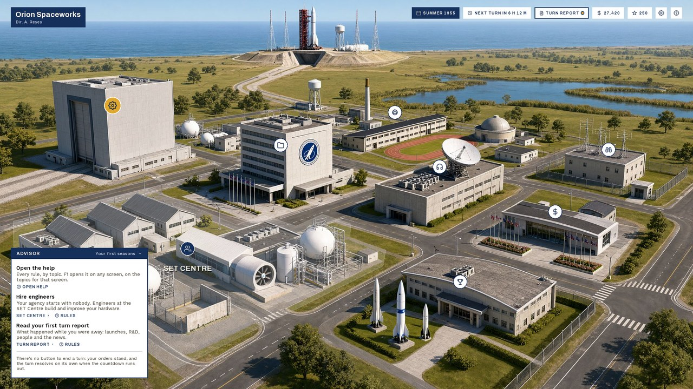
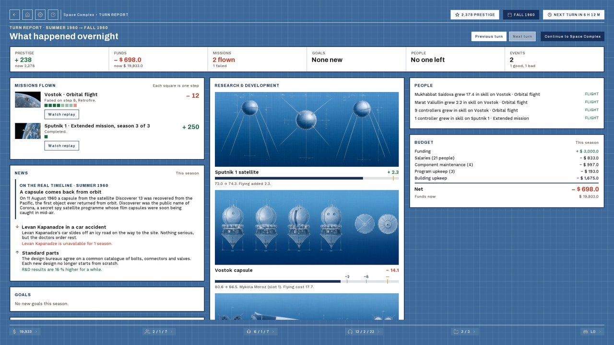
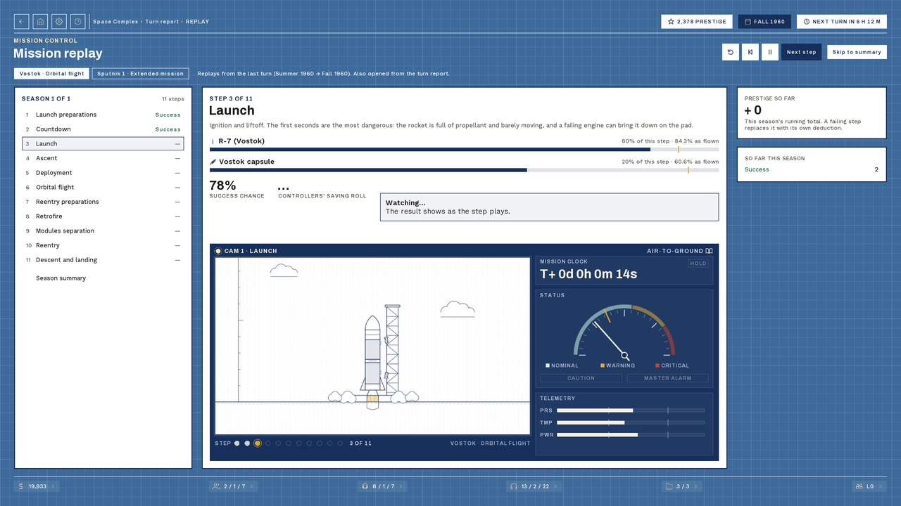
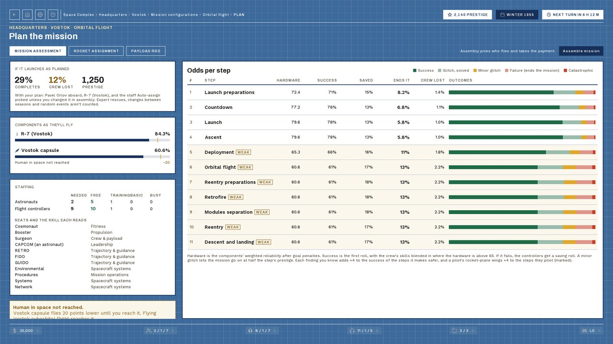
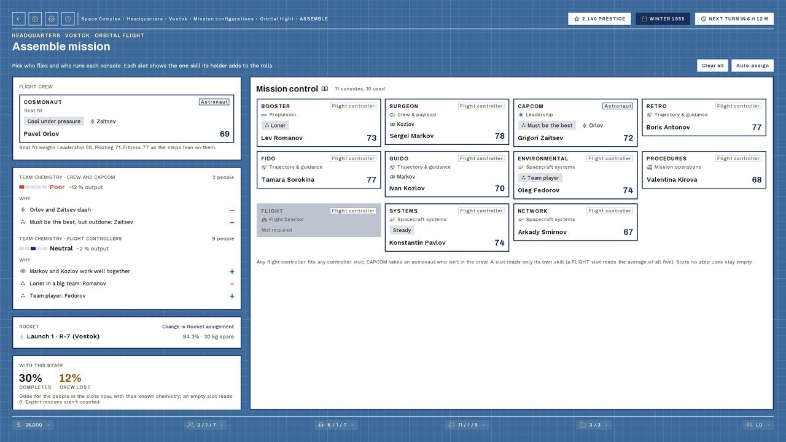
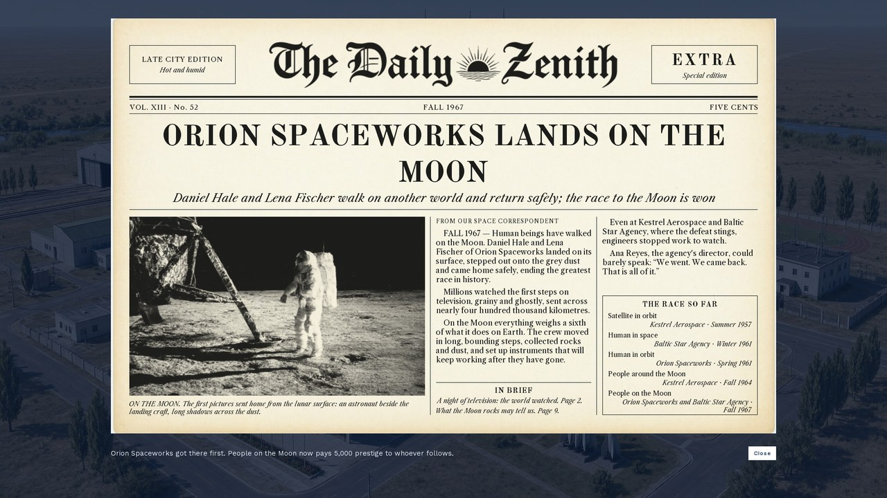
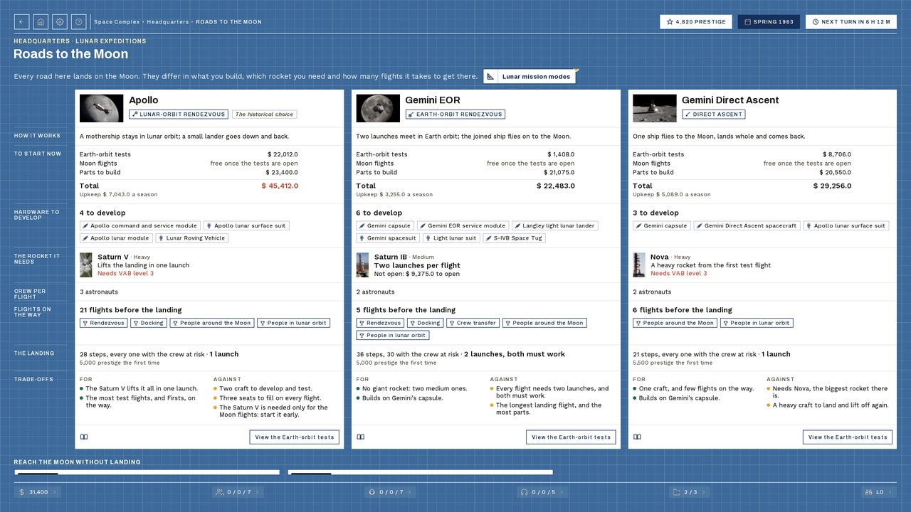
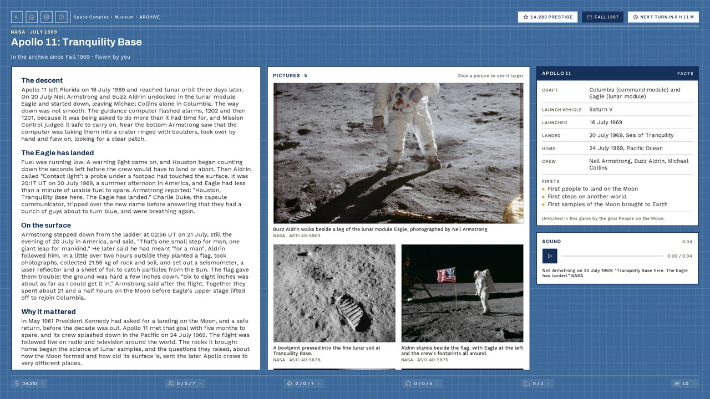
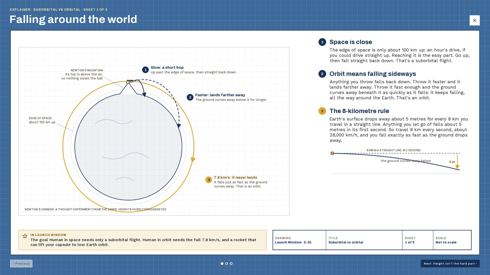
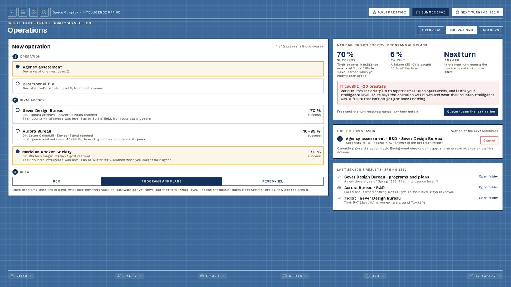

<p align="center">
  
</p>

<h1 align="center">Launch Window</h1>

<p align="center"><em>Stay one small step ahead.</em></p>

<p align="center">
  <a href="https://github.com/mariokoehler/Launch-Window/releases/latest"></a>
  <a href="https://github.com/mariokoehler/Launch-Window/wiki"></a>
  
  
</p>

**Launch Window** is an asynchronous multiplayer space-race management game. Each player runs a space
agency from Winter 1955: hire the people, fund the research, open programs and fly missions, from the
first satellite to the Moon. Players log in whenever it suits them and give their orders; at a fixed time
each day the server resolves every agency's season at once. A game runs for weeks to months, for a group
of about four to ten agencies.

A launch window is the short stretch of time a rocket has to lift off. In this game, every day is yours.

<p align="center">
  
</p>

## Contents

- [How a game plays](#how-a-game-plays)
- [Features](#features)
- [Screenshots](#screenshots)
- [Status](#status)
- [Playing](#playing)
- [Hosting a game](#hosting-a-game)
- [Building from source](#building-from-source)
- [Project layout](#project-layout)
- [Documentation](#documentation)
- [Credits](#credits)
- [Contributing](#contributing)
- [Legal](#legal)

## How a game plays

- **One turn is one season.** At a fixed time each day the server resolves every agency's season at once:
  missions fly, research moves on, money comes in and the newspaper goes to print.
- **Nobody waits for anybody.** Log in, read what happened, give your orders for the next turn and log
  off. Five minutes is enough; an evening of planning is welcome too. Orders are saved as you give them.
- **Pick a side's style.** Each agency flies a NASA-style or a Soviet-style program tree, with the
  historical rockets and spacecraft, against every other agency in the game.
- **Win the race.** The first agency to reach the game's goals (by default a satellite in orbit, a person
  in orbit and a crewed Moon landing) wins. Play goes on after that, for the Firsts still open.

## Features

- **People worth caring about.** Astronauts, engineers and flight controllers with skills, hidden traits,
  ambitions, loyalty and friendships. They train, retire, resign, get poached by rivals, and remember how
  you treated them. Those lost in flight are remembered on the memorial.
- **Hardware you develop.** 55 programs and 186 mission configurations, from Sputnik and Vostok to Apollo,
  Soyuz and the planetary probes. Put engineers on R&D, decide when a rocket or capsule is reliable enough
  to fly, and answer the R&D decisions that come up along the way.
- **Several roads to the Moon.** Apollo's lunar-orbit rendezvous, Gemini by Earth-orbit rendezvous or by
  direct ascent on Nova, the Soviet 7K-L3 and the LK-700, compared side by side and never ranked.
- **Missions flown step by step.** Every step of a flight succeeds or fails on its own odds, with the
  hardware's reliability, the crew's skills and the controllers' saving throw. The mission replay plays
  each step as a short film on a mission-control console, with radio calls and sound.
- **Rivals you can see.** Their Firsts make the front page of *The Daily Zenith*, and you can answer them
  in the paper. The Intelligence Office spies on them, for a price; publishing a finding helps them too,
  and pays you in prestige.
- **A shared contract market,** where clients pay money, not prestige, for flights you've already mastered.
- **The real history and engineering.** History notes on every program and component, 30 illustrated
  explainers on why the hard parts were hard, real space-race news each season, and an archive of real
  missions with NASA's pictures and sound that opens as the game reaches their goals.
- **Help on every screen.** Press F1 for the rules that matter where you are. The same help is in the
  [wiki](https://github.com/mariokoehler/Launch-Window/wiki).

## Screenshots

| | |
|:---:|:---:|
| <br>The turn report: what happened overnight | <br>A mission's replay on the console |
| <br>The odds of every step of a mission | <br>Crew, CAPCOM and controllers, and their chemistry |
| <br>*The Daily Zenith* on a First | <br>The roads to the Moon side by side |
| <br>The archive: real missions, real pictures | <br>An explainer: how the real thing works |
| <br>The Intelligence Office | |

## Status

Launch Window is in play testing. Every building of the Space Complex has its screens, and the full
program tree is playable from 1955 to the Moon and the planets. The first full game is planned for
January 2027. Rules and numbers still change between play tests; the roadmap and its backlog are in
[`design.md` §5](design.md#5-implementation-roadmap-milestones--slices).

## Playing

You need a server to play on: someone in your group hosts the game (see below) and tells you its
address.

1. Download `LaunchWindow-Client.zip` from the [latest release](https://github.com/mariokoehler/Launch-Window/releases/latest)
   and unzip it anywhere. It is a Windows build with its own Java runtime; nothing else to install.
2. Run `LaunchWindow.exe`, enter the server's address, and the login and password you want. The first
   time, the game offers to create the account.
3. Found your agency: pick a side's style, name it and its director.
4. Read the advisor's card on the hub for your first steps, and press **F1** on any screen for the rules.

The client and server must be the same release: the server refuses an older client. Run `update.cmd`
in the client's folder to fetch the latest release.

Releases lag behind `master` while the game is in play testing. To play the current state, build the
client from source (below).

## Hosting a game

A server runs one game. It is a small Java process with no database: the whole game is a folder of JSON
files, and it zips that folder before every turn it resolves.

**With Docker.** Every release publishes a server image to `ghcr.io/mariokoehler/launchwindow-server`.
[`deploy/docker-compose.yml`](deploy/docker-compose.yml) is a ready compose file: it pins the image's
tag, exposes TCP port 45825 and bind-mounts the data folder. Pin the same tag as your players' client.

**From source.** `mvn -pl server compile exec:java` runs the server from the repo, with its data in
`data/`.

On its first start the server writes `game-meta.json` into its data folder. Edit it and restart:

- `schedule`: the days the turn resolves (`activeDays`), the time (`resolutionTime`) and the
  `timezone`; daily for friends, Monday to Friday for colleagues;
- `blackouts`: holidays without a resolution, added any time;
- `declaredGoalIds`: the goals that win the race;
- `bots`: agencies the server plays itself, to fill a small group.

A bad turn can be undone: stop the server and run `TurnRollback` (see the comments in the compose file).

## Building from source

**Prerequisites:** JDK 25 and Maven 3.8 or later. The release client is built for Windows; the server
runs anywhere Java does.

```sh
mvn clean package                             # build everything and run the tests
mvn install -pl core -am -DskipTests          # install core: the other modules resolve it from ~/.m2
mvn -pl server compile exec:java              # run a server on localhost:45825
mvn -pl lwjgl3 compile exec:exec              # run the client
```

`lwjgl3`, `server` and `dev-tools` take `core` from your local Maven repository, so install it again
after every change to `core`.

**Release builds.** `mvn -pl lwjgl3 -am -Prelease-client -DskipTests verify` makes the client zip with
jpackage (`lwjgl3/target/LaunchWindow-Client.zip`). Pushing a tag `vX.Y.Z` runs the GitHub Actions
workflows that publish the client zip as a release and the server image to GHCR.

**Dev tools** (in `dev-tools`): a command-line client, a replay viewer for any mission and outcome
(`mvn -pl dev-tools compile exec:exec@replayer`), and bot playouts that play whole games headless to
tune the rules. `ScreenSnapshot` (in the client's tests) renders every screen state to PNG for checking
layouts; the screenshots here and in the wiki come from it.

## Project layout

| Path | What it holds |
|---|---|
| `core/` | Everything headless: the model, the rules engine, content loading, the network messages and the client's view logic |
| `lwjgl3/` | The libGDX desktop client |
| `server/` | The KryoNet server: accounts, the turn scheduler, persistence |
| `dev-tools/` | Development and analysis tools: dev client, replayer, bot playouts, the wiki exporter |
| `assets/` | Everything the game ships: the content packs (`assets/content/`), art, sound, fonts and UI |
| `assets-raw/` | Source art and the scripts that turn it into game assets |
| `deploy/` | The server's Docker Compose file |
| `docs/` | The README's screenshots |

The game's rules and numbers are data: the content packs under `assets/content/` define every program,
configuration, component and goal; the rules engine in `core` reads them.

## Documentation

- [**The wiki**](https://github.com/mariokoehler/Launch-Window/wiki): the rules of the game, with
  screenshots. It is generated from the in-game help.
- [`design.md`](design.md): what the game is and why, how every system works, the architecture and the
  roadmap.
- [`ui-spec.md`](ui-spec.md): every screen and shared component.
- [`assets/CREDITS.md`](assets/CREDITS.md): every third-party asset and its licence.

## Credits

Made by Mario Köhler.

- **Sound and pictures of the real missions:** NASA, public domain. Further sound effects from Pixabay,
  under the Pixabay Content License.
- **Fonts:** Archivo, Work Sans, Old Standard TT and Libre Caslon Text, under the SIL Open Font License.
- **Generated art and voices:** the people's portraits, the goal patches, the components' blueprint
  drawings and the newspaper's photos were generated with a local image model, and the replay's radio
  calls with a local speech model.
- **Libraries:** [libGDX](https://libgdx.com/), [KryoNet](https://github.com/crykn/kryonet),
  [Jackson](https://github.com/FasterXML/jackson), [gdx-video](https://github.com/libgdx/gdx-video) and
  JUnit 5.

Every third-party asset and its credit is listed in [`assets/CREDITS.md`](assets/CREDITS.md).

## Contributing

Launch Window is a personal project, and it doesn't take contributions: please don't open pull requests.

## Legal

Launch Window is a non-commercial fan project inspired by *Buzz Aldrin's Space Program Manager*
(Slitherine / Matrix Games). It is not affiliated with or endorsed by Slitherine, Matrix Games or Buzz
Aldrin. Its name, text, art, sound and code are its own: none of the original game's is included. The
real programs, people and events of the space race are history.

**Licence:** none yet. The source is public to read and learn from, but all rights are reserved: please
don't redistribute it or its assets without asking. Third-party assets keep their own licences
(`assets/CREDITS.md`).
